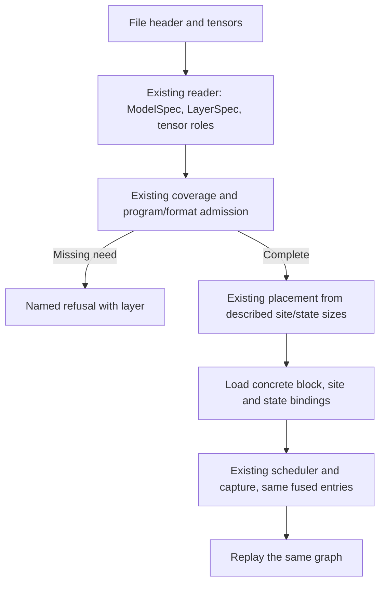

# Layer composition: source census and lift design (#609)

Snapshot: **`faa81674ff09ebc1871652e7416cd00db49616fe`**, release main after the MiniMax/Solar/Raon merge; reviewed 2026-10-22.
This note completes the **census and design** scope of [#609](https://github.com/midagedev/bloomery/issues/609).
It does not implement a body lift, claim a new runnable architecture, or supply GPU/performance evidence.

## 1. What was counted

The input is the snapshot's [family ownership table](https://github.com/midagedev/bloomery/blob/faa81674ff09ebc1871652e7416cd00db49616fe/tools/families.tsv) and
[canonical architecture registry](https://github.com/midagedev/bloomery/blob/faa81674ff09ebc1871652e7416cd00db49616fe/tools/arch-registry.tsv). The latter's 15 canonical rows are
covered; aliases are not extra families. `gemma4a`, `gemma4v`, `minicpmv47` and `qwen38d` are the four declared
non-architecture gate groups. An entry in this census is not a claim that its reader/program is runnable.

Scope: tracked Rust matched by the family globs, plus every private `crates/app/src/arch/<namespace>/` adapter.
For the latter, membership is derived by mirroring that same namespace through the existing model/gpu globs;
there is no second family-name table. A private app namespace with no owner is refused, not silently omitted.
Common integration code outside those paths is not arbitrarily apportioned to models. Its model-name debt remains
the existing [model-tax inventory](https://github.com/midagedev/bloomery/blob/faa81674ff09ebc1871652e7416cd00db49616fe/tools/model-tax.tsv) and its ratchet, not a replacement tax.
Non-Rust fixture data/scripts are outside this Rust-source denominator. Feature branches are not pruned.

Classification is semantic, at whole AST item/method/file-level-macro granularity:

- **F**: a fact-bearing primitive, tensor/description item or compiled instance binding. Incidental construction
  inside a mixed F item is still counted there. This is a conservative item census, **not irreducible fact LOC**.
- **G**: composable construction, loading, state transport, scheduling, placement or serving glue. It includes code
  already shared under a historically family-named crate; it is **not a deletion estimate**.
- **V**: independent verification, referee/oracle, fixture, gate or teacher-forced checking support. This takes
  precedence over fact/glue distinctions inside a verification owner. A production seat or speculative-verification
  serving path is not V merely because its file lives in gpu-gates or its method says `verifying`.

The parser excludes comments and blank rows. Each physical code-bearing row is assigned once, to its first AST leaf;
imports/module/impl scaffolding is G, while file-level macro instances receive explicit semantic review. Inline tests,
`cfg(test)` containers and path-owned gate/refset/test files are V. It does not count words that merely look like code
inside comments, nor treat comment markers inside string literals as comments. Review defaults, exact-symbol
exceptions and SHA-256 for every source file are in [the census data](layer-composition-census.json).

**Rows are non-additive across families.** The Qwen source glob and its app namespace are deliberately shared by
several groups. The union below counts each source row once. Already-common `shared_routed`, `prompt_walk` and
`block` code remains in DeepSeek's ownership glob; those G rows are not still-private copies to extract again.

| Family / gate group | F | G | V | Code rows | Files |
|---|---:|---:|---:|---:|---:|
| `deepseek2` | 2359 | 3047 | 948 | 6354 | 14 |
| `deepseek41` | 8103 | 24971 | 42310 | 75384 | 111 |
| `gemma-embedding` | 247 | 25 | 690 | 962 | 8 |
| `gemma-embedding2` | 838 | 595 | 3508 | 4941 | 13 |
| `gemma4a` | 738 | 451 | 536 | 1725 | 10 |
| `gemma4v` | 849 | 530 | 330 | 1709 | 7 |
| `glm5next` | 2601 | 11532 | 21473 | 35606 | 63 |
| `mimo2` | 1056 | 3399 | 6741 | 11196 | 27 |
| `minicpmv47` | 9426 | 21432 | 5744 | 36602 | 54 |
| `minimax-m3` | 1561 | 1371 | 2598 | 5530 | 22 |
| `nemotron_h` | 1119 | 1135 | 2752 | 5006 | 22 |
| `nemotron_h_moe` | 1515 | 2220 | 2597 | 6332 | 20 |
| `qwen35` | 11566 | 22814 | 11218 | 45598 | 67 |
| `qwen35moe` | 10782 | 22207 | 17864 | 50853 | 59 |
| `qwen38d` | 8332 | 20955 | 2277 | 31564 | 39 |
| `qwen3moe` | 8697 | 23277 | 10091 | 42065 | 56 |
| `qwen4exp` | 10794 | 24295 | 26630 | 61719 | 72 |
| `solar-open2` | 493 | 2009 | 1655 | 4157 | 25 |
| `raon1` | 2263 | 2918 | 3162 | 8343 | 25 |
| **Deduplicated union** | **36779** | **81592** | **146602** | **264973** | **505** |

## 2. Reproduction and limits

[The companion](layer-composition-census.py) reads the recorded commit's **git objects**, not a dirty worktree or the
current branch's changed code. It verifies the source/table hashes, complete ownership set, parser versions, AST
partition, every classification override, all twin/lift selectors, census totals and forecast arithmetic. It exits
nonzero on a mismatch. The semantic judgments themselves remain reviewable input, not something syntax proves.

Pinned dependencies: `tree-sitter==0.25.2`, `tree-sitter-rust==0.24.2`. No Cargo build, model, NVIDIA driver or lease is
needed. One isolated dependency setup, including hosts without an installed pip:

```sh
curl -fsSL https://bootstrap.pypa.io/pip/pip.pyz -o /tmp/bloomery-census-pip.pyz
python3 /tmp/bloomery-census-pip.pyz install --target /tmp/bloomery-census-deps tree-sitter==0.25.2 tree-sitter-rust==0.24.2
PYTHONPATH=/tmp/bloomery-census-deps python3 docs/research/layer-composition-census.py --root .
```

`--json` emits exact source spans, paired boundaries and the selected source items behind each forecast. A shallow
clone must fetch the recorded commit first. The normal CLI was exercised against this snapshot: all source/override
checks passed, with no Rust parse errors; the code-row partition, 72 source-resolved candidate pairs and nine lift
calculations matched the stored data. This is source-analysis evidence, not runtime equivalence of an unimplemented lift.

Throwaway boundary smoke also passed: comment markers inside a multiline raw string remain code; real comments are
excluded; `cfg(not(test))` remains production while a `cfg(test)` impl is wholly V; file-level macros are reviewable
and two same-line items never double-count a row. Three runs of the real CLI refused a bad source hash, an unknown
classification item and an unknown twin selector with exit 2 and no misleading success table. No permanent probe remains.

## 3. Existing owners and the target contract

The tree already has the description, not a blank space for another layer DSL:

- [`models::ModelSpec` / `LayerSpec`](https://github.com/midagedev/bloomery/blob/faa81674ff09ebc1871652e7416cd00db49616fe/crates/models/src/lib.rs) own ordered layers, detailed mixer,
  FFN/activation, residual and extras. Norm facts come from the existing RMS/mixer/encoder/HC descriptions and tensor
  roles. If a genuinely missing fact cannot be expressed there, extend that owner with its cited fact before admitting
  it; do not hide a guessed default in a private body or a parallel description.
- [`runtime::layer::Layer::of`](https://github.com/midagedev/bloomery/blob/faa81674ff09ebc1871652e7416cd00db49616fe/crates/runtime/src/layer.rs) supplies coarse execution kinds.
  It does not make GDN, KDA and RDA interchangeable merely because all lower to `DeltaRule`. The detailed kind,
  write/erase gates, activation/clamp, norm, rotary pairing, residual wiring and shared-source rules remain binding facts.
- [`runtime::sched::LayerProgram` / `walk`](https://github.com/midagedev/bloomery/blob/faa81674ff09ebc1871652e7416cd00db49616fe/crates/runtime/src/sched.rs) and the existing host legs
  own scheduling/exchange. State ownership/retention continues through the existing runtime state and checkpoint owners,
  including `LayerSpec::reads`/owning rows/keys. A shared source is not another allocation or another writer.
- [`model::arch::coverage`](https://github.com/midagedev/bloomery/blob/faa81674ff09ebc1871652e7416cd00db49616fe/crates/model/src/arch/coverage.rs) remains the **single block-coverage refusal owner**:
  `Need` plus layer, program admission, role-specific weight/routed-format pins, tokenizer and tool parser.
  `Need::Program`, `NoEngram` and format/parser refusals are not removed to make composition appear supported.
  Existing file/shape, placement, media and sequence checks remain with their current owners and are not bypassed.

Target runnable path, composed once into the existing execution shape:



A binding retains the original tensor role/type/layout, norm parameters, projection backend, position/live-count
producer, cache/state owner and row/slot views. Resolve its choices at load or the existing capture-shape boundary;
prompt-shape dispatch remains where it already belongs. Store only the concrete existing row programs/borrowed
views, not copied model descriptions, per-step metadata allocations or a new opcode VM. Eager verification calls the
same concrete launch programs; it must not become a second numerical implementation or a new interpreted token loop.
A fusion crossing a proposed boundary stays **one block**, with its current scratch lifetimes and launches.

Keep the dependency direction: the host-only model crate cannot depend on GPU factory types. GPU-side implementation
bindings refer to the **existing `Available` rows/predicates** and supply their projected row references to the existing
`check_with` owner; do not recopy the predicates into a second capability catalog. A missing implementation contributes
no row and is refused there. Name a current row if a stable Rust reference is needed, rather than introducing another
semantic block vocabulary or matching its prose string. A future composed-program arm is admitted in the same owner
only when the full binding and per-role site-format intersection are enforced. Until then the program refusal stays.
A kernel existing somewhere in the tree is not proof that the selected program launches it.

The same description feeds the existing placement/resource owners, not a second memory policy. Reuse loaded weight
joins, scratch arenas, row views and host ports; no extra copies, kernels, synchronizations or changed summation order.
Preserve slot-local destinations and asynchronous writer obligations ([#612](https://github.com/midagedev/bloomery/pull/612)),
including the distinction between distinct cache-valid positions and repeated invalid sentinels. Ring/chunk bindings
must additionally retain their actual physical destination/visibility contracts, not assume raw position uniqueness
is a universal ring proof.

The seat consumes that program's existing capabilities and plan. Keep tokenizer/template/tool/media admission,
checkpoint and prefix-retention rules, MTP/NextN lanes/reserves, and supported slot counts. No architecture-name
fallback that accepts an unsupported fact, no new seat-only coverage list, and no deprecated family shim after cutover.

### Already landed in this snapshot

[MiniMax/Solar #599](https://github.com/midagedev/bloomery/pull/599) already shares routed execution, prompt walking,
application batch plumbing and the hybrid serving seat. [GLM/Solar #602](https://github.com/midagedev/bloomery/pull/602)
already shares the tier side. The concrete owners include `gpu-deepseek41::shared_routed`, `prompt_walk`,
`app::arch::Batch`, `serve_seats::hybrid`, `gpu::host::leg_tier` and `gpu::model::agreed`. Three old candidate pairs
(agreement helpers, Solar's private routed constructor and the private tier openers) are retired in the data.
The earlier claim that Solar's tier is unimplemented is obsolete at this snapshot. Do not implement those lifts twice.
Existing tier/resource policy remains the [tierengine design](tierengine.md)'s owners.

## 4. Lift order and forecasts

Each row is one **move**, never a numerical rewrite disguised as sharing. Selected item sets are disjoint. The data
lists every item/span. Forecasts charge both the new common implementation and the retained/new family bindings:

`net removed = measured old code rows - new common owner budget - binding budget`.

The ranges are design estimates, not executed deletions or speed claims. They include retained descriptor/admission
code and call-site/interface cost; they do not count deleting tests/oracles as a win. Re-census after each move,
because later bindings can change size. Do not sum these as guaranteed savings.

| Order | Selected old code rows | New common owner [forecast] | Retained/new bindings [forecast] | Net rows removed [derived forecast] |
|---|---:|---:|---:|---:|
| **C1** — Slot row admission and id/error views | 85 | 32–42 | 4–8 | **35–49** |
| **C2** — Described host-layer construction | 155 | 30–45 | 60–85 | **25–65** |
| **C3** — HC row input/output bindings | 125 | 65–85 | 12–20 | **20–48** |
| **C4** — Qwen sequence GDN phase | 147 | 85–105 | 12–20 | **22–50** |
| **C5** — MiMo K192 attention description | 251 | 140–170 | 30–45 | **36–81** |
| **C6** — MiniMax step/pass attention description | 380 | 200–250 | 40–60 | **70–140** |
| **C7** — Qwen narrow/wide fact-owned front | 217 | 120–150 | 25–35 | **32–72** |
| **C8** — Existing application one-card/context guard | 69 | 0–0 | 36–42 | **27–33** |
| **C9** — Node-plan lowering from described state terms | 86 | 25–40 | 20–30 | **16–41** |

C1–C6 establish checked views and shared described operations; C7 consumes the earlier row-operation boundaries.
C8 reuses an owner that already exists, not another abstraction. C9 follows the described state/site boundary and
keeps draft/slot/oracle placement terms explicit. Other candidate pairs below are not permission for a blind textual
merge. In particular, keep the Qwen/Raon prompt-tap envelope within a complete resolved application adapter rather
than add a micro-helper whose callback/lifetime interface can cost as much as the duplicate.

For **every** lift: migrate all actual consumers together, delete obsolete private code/aliases, keep the owning
static checks and the real `just affected` selection, and obtain the complete scan-set `ptx-scan`/canonical move proof
against its immediate base. Kernel entry/resource rows must stay equal; a moved stream or incompatible primitive is a
refusal to call it a move, not a reason to relax a pin. PTX identity alone does not prove host operands or launch order:
exercise the changed path, compare existing eager/captured/step/pass/slot/verify behavior and graph-node/copy counts
where applicable, and keep every numerical band and fault/refusal clause. These are **future acceptance checks**, not
claims that this documentation PR ran GPU gates.

### C1. Slot row admission and id/error views

Owner: gpu::model sequence/row utilities.

Sources: [qwen3moe/body35_slots::slot_rows](https://github.com/midagedev/bloomery/blob/faa81674ff09ebc1871652e7416cd00db49616fe/crates/gpu/src/arch/qwen3moe/body35_slots.rs#L593-L617); [qwen3moe/body35_slots::slot_ids](https://github.com/midagedev/bloomery/blob/faa81674ff09ebc1871652e7416cd00db49616fe/crates/gpu/src/arch/qwen3moe/body35_slots.rs#L620-L627); [qwen3moe/body35_slots::slot_twice](https://github.com/midagedev/bloomery/blob/faa81674ff09ebc1871652e7416cd00db49616fe/crates/gpu/src/arch/qwen3moe/body35_slots.rs#L630-L632); [qwen3moe/body35_slots::no_parked](https://github.com/midagedev/bloomery/blob/faa81674ff09ebc1871652e7416cd00db49616fe/crates/gpu/src/arch/qwen3moe/body35_slots.rs#L635-L637); [qwen3moe/body38::slot_rows](https://github.com/midagedev/bloomery/blob/faa81674ff09ebc1871652e7416cd00db49616fe/crates/gpu/src/arch/qwen3moe/body38.rs#L5444-L5475); [qwen3moe/body38::slot_ids](https://github.com/midagedev/bloomery/blob/faa81674ff09ebc1871652e7416cd00db49616fe/crates/gpu/src/arch/qwen3moe/body38.rs#L5478-L5485); [qwen3moe/body38::slot_twice](https://github.com/midagedev/bloomery/blob/faa81674ff09ebc1871652e7416cd00db49616fe/crates/gpu/src/arch/qwen3moe/body38.rs#L5488-L5490); [qwen3moe/body38::no_parked](https://github.com/midagedev/bloomery/blob/faa81674ff09ebc1871652e7416cd00db49616fe/crates/gpu/src/arch/qwen3moe/body38.rs#L5493-L5495).

Invariant: Preserve ordered nonempty tiling, parked-count/id bounds and named refusals; require slot-0-first only for the retained-prefix arena binding, never by model name.

Proof focus: `gate-gpu-qwen35moe-e2e`, `gate-gpu-qwen4exp-e2e`, `gate-gpu-qwen4exp-mtp`; the complete current `just affected` list still applies.

### C2. Described host-layer construction

Owner: model::moe HostLayerSpec and existing HostLayer builders.

Sources: [deepseek41/host::layer](https://github.com/midagedev/bloomery/blob/faa81674ff09ebc1871652e7416cd00db49616fe/crates/model/src/arch/deepseek41/host.rs#L17-L50); [glm5next/host::layer](https://github.com/midagedev/bloomery/blob/faa81674ff09ebc1871652e7416cd00db49616fe/crates/model/src/arch/glm5next/host.rs#L16-L51); [mimo2/host::layer](https://github.com/midagedev/bloomery/blob/faa81674ff09ebc1871652e7416cd00db49616fe/crates/model/src/arch/mimo2/host.rs#L17-L40); [solar2/host::layer](https://github.com/midagedev/bloomery/blob/faa81674ff09ebc1871652e7416cd00db49616fe/crates/model/src/arch/solar2/host.rs#L49-L74); [minimaxm3/host::layer](https://github.com/midagedev/bloomery/blob/faa81674ff09ebc1871652e7416cd00db49616fe/crates/model/src/arch/minimaxm3/host.rs#L16-L50).

Invariant: Retain layer admission, dense prefixes, trunk/NextN bounds, exact stack roles/widths, per-layer clamps and OAI alpha/limit; do not equate OAI and ordinary SwiGLU.

Proof focus: `gate-gpu-routed-legs`, `gate-gpu-glm5next-e2e`, `gate-gpu-minimaxm3-e2e`; the complete current `just affected` list still applies.

### C3. HC row input/output bindings

Owner: existing gpu-deepseek41::hc row-operation owner.

Sources: [src/program::hc_in](https://github.com/midagedev/bloomery/blob/faa81674ff09ebc1871652e7416cd00db49616fe/crates/gpu-glm5next/src/program.rs#L350-L395); [src/program::hc_out](https://github.com/midagedev/bloomery/blob/faa81674ff09ebc1871652e7416cd00db49616fe/crates/gpu-glm5next/src/program.rs#L400-L419); [src/prefill::hc_in](https://github.com/midagedev/bloomery/blob/faa81674ff09ebc1871652e7416cd00db49616fe/crates/gpu-glm5next/src/prefill.rs#L2371-L2408); [src/prefill::hc_out](https://github.com/midagedev/bloomery/blob/faa81674ff09ebc1871652e7416cd00db49616fe/crates/gpu-glm5next/src/prefill.rs#L2412-L2432).

Invariant: Bind the same HC weights/eps/iters and preserve token grouping, fold/post order, ping-pong stream and fault-layer identity; do not substitute Raon chart finishing.

Proof focus: `gate-gpu-glm5next-e2e`, `gate-gpu-glm5next-mtp`; the complete current `just affected` list still applies.

### C4. Qwen sequence GDN phase

Owner: existing Qwen GDN sequence phase and operation backend.

Sources: [qwen3moe/program38::gdn_seq](https://github.com/midagedev/bloomery/blob/faa81674ff09ebc1871652e7416cd00db49616fe/crates/gpu/src/arch/qwen3moe/program38.rs#L1072-L1137); [qwen3moe/wide38::gdn](https://github.com/midagedev/bloomery/blob/faa81674ff09ebc1871652e7416cd00db49616fe/crates/gpu/src/arch/qwen3moe/wide38.rs#L2110-L2192).

Invariant: Keep GEMV/GEMM activation forms, each-row versus last-lane writes, stamps, conv/delta order and sequence-local state; do not replace the separate step kernel with a sequence kernel.

Proof focus: `gate-gpu-qwen4exp-e2e`, `gate-gpu-qwen4exp-mtp`; the complete current `just affected` list still applies.

### C5. MiMo K192 attention description

Owner: existing MiMo K192 row attention and site/flash owners.

Sources: [src/attn::attention](https://github.com/midagedev/bloomery/blob/faa81674ff09ebc1871652e7416cd00db49616fe/crates/gpu-mimo2/src/attn.rs#L95-L168); [src/slots::attention](https://github.com/midagedev/bloomery/blob/faa81674ff09ebc1871652e7416cd00db49616fe/crates/gpu-mimo2/src/slots.rs#L513-L604); [src/prefill::attention](https://github.com/midagedev/bloomery/blob/faa81674ff09ebc1871652e7416cd00db49616fe/crates/gpu-mimo2/src/prefill.rs#L790-L874).

Invariant: Keep per-sequence position/cache views, ring/chunk visibility, value scaling, sinks/window/score and row-major versus token-major projection forms; identical launch trace.

Proof focus: `gate-gpu-mimo2-flash`, `weekly-gpu-mimo2-e2e`; the complete current `just affected` list still applies.

### C6. MiniMax step/pass attention description

Owner: existing MiniMax attention description over Site/MSA/KeyWalk.

Sources: [src/step::attend_layer](https://github.com/midagedev/bloomery/blob/faa81674ff09ebc1871652e7416cd00db49616fe/crates/gpu-minimaxm3/src/step.rs#L226-L405); [src/prefill::attend](https://github.com/midagedev/bloomery/blob/faa81674ff09ebc1871652e7416cd00db49616fe/crates/gpu-minimaxm3/src/prefill.rs#L357-L565).

Invariant: Keep append-before-index-score, per-row causal live counts, block-local picks/ties, mutated index-key input and dummy-value scratch; reuse the landed prompt walker and block flash.

Proof focus: `gate-gpu-minimaxm3-msa`, `gate-gpu-minimaxm3-e2e`, `gate-gpu-minimaxm3-prefill`; the complete current `just affected` list still applies.

### C7. Qwen narrow/wide fact-owned front

Owner: one fact-owned Qwen row front over existing runtime::sched.

Sources: [qwen3moe/program38::front](https://github.com/midagedev/bloomery/blob/faa81674ff09ebc1871652e7416cd00db49616fe/crates/gpu/src/arch/qwen3moe/program38.rs#L514-L587); [qwen3moe/wide38::front](https://github.com/midagedev/bloomery/blob/faa81674ff09ebc1871652e7416cd00db49616fe/crates/gpu/src/arch/qwen3moe/wide38.rs#L1640-L1782).

Invariant: Retain HC/PLe/GDN/QSA phase order, projection backend and row/cache/sequence bindings; resolve operation choices before capture, not with a new step interpreter.

Proof focus: `gate-gpu-qwen4exp-e2e`, `gate-gpu-qwen4exp-mtp`; the complete current `just affected` list still applies.

### C8. Existing application one-card/context guard

Owner: existing app::arch::one_card_ctx.

Sources: [arch/deepseek41::plan](https://github.com/midagedev/bloomery/blob/faa81674ff09ebc1871652e7416cd00db49616fe/crates/app/src/arch/deepseek41/mod.rs#L53-L75); [arch/glm5next::plan](https://github.com/midagedev/bloomery/blob/faa81674ff09ebc1871652e7416cd00db49616fe/crates/app/src/arch/glm5next/mod.rs#L71-L93); [arch/mimo2::plan](https://github.com/midagedev/bloomery/blob/faa81674ff09ebc1871652e7416cd00db49616fe/crates/app/src/arch/mimo2/mod.rs#L69-L91).

Invariant: Reuse the existing one-stage-card guard and checked context conversion, retaining the real plan callback, expert-tier allowance and model-specific reserves/slot counts.

Proof focus: `gate-app`; the complete current `just affected` list still applies.

### C9. Node-plan lowering from described state terms

Owner: existing model::arch::place_hybrid and placement::nodes lowering.

Sources: [deepseek41/place::plan_slots_nodes](https://github.com/midagedev/bloomery/blob/faa81674ff09ebc1871652e7416cd00db49616fe/crates/model/src/arch/deepseek41/place.rs#L206-L232); [glm5next/place::plan_slots_nodes](https://github.com/midagedev/bloomery/blob/faa81674ff09ebc1871652e7416cd00db49616fe/crates/model/src/arch/glm5next/place.rs#L592-L654).

Invariant: Supply described KV/compressor/KDA/checkpoint/beside/prompt terms and oracle bounds; preserve node/slot allocation reports and NoRoom/refusal behavior.

Proof focus: `gate-ds41-place`, `gate-gpu-ds41-twocard`, `gate-gpu-glm5next-twocard`; the complete current `just affected` list still applies.


## 5. Boundaries a common spelling does not erase

- Raon chart mHC and DeepSeek HC are not a blanket bitwise finishing-core substitution: the current fold paths differ
  in contraction/rounding. Preserve each actual post/mean geometry and rounding too; module prose saying “same rule”
  is not the canonical proof. Keep genuinely forced fused implementations.
- Audio pointwise preserves nonfinite inputs and may round through BF16; vision clamp treats infinities differently.
  Gemma4V's sandwich/value norms, rotary/scale rules and RADIO's biased head-80 block are different descriptions.
- Dense Nemotron's Mamba step scan and latent-MoE's SSD prompt scan, Q8_0 versus Q5_0 embedding, GQA groups and projection
  forms are not interchangeable. In latent MoE, preserve norm-form lifetime before same-width latent quantization and
  the latent-domain host/card/shared combine order.
- The target DeepSeek router documents an instruction-stream constraint on const-generic extraction. Retain the
  specialization unless the repository's strict move proof actually discharges it. Preserve biased ranking, ties and
  unbiased weights; similar sigmoid/sqrt-softplus code is not one routing rule.
- Preserve borrowed-window byte/element conversions and the existing checked arithmetic, compressed/index source
  ownership, PLE rings, retained-prefix layouts, and sequence exchange/restoration on failure. Do not turn those into
  model-name branches or lose them while lifting a launch wrapper.

## 6. Source-resolved candidate catalog

This is a near-twin **inventory**, including false twins, already-common lower primitives and bindings that need
factual separation first—not a list of 72 interchangeable implementations. The linked spans are the frozen source;
[the data](layer-composition-census.json) records exact qualified selectors, differences, proposed owner and source
proof for each pair. The normal CLI resolves every selector exactly once before reporting success.

1. [nemotron_h/place::describe](https://github.com/midagedev/bloomery/blob/faa81674ff09ebc1871652e7416cd00db49616fe/crates/model/src/arch/nemotron_h/place.rs#L28-L36) ↔ [nemotron_h_moe/place::describe](https://github.com/midagedev/bloomery/blob/faa81674ff09ebc1871652e7416cd00db49616fe/crates/model/src/arch/nemotron_h_moe/place.rs#L32-L40) — binding-first; preserve stated differences before attempting a move.
2. [nemotron_h/step::enqueue](https://github.com/midagedev/bloomery/blob/faa81674ff09ebc1871652e7416cd00db49616fe/crates/gpu/src/arch/nemotron_h/step.rs#L73-L132) ↔ [nemotron_h_moe/body::enqueue](https://github.com/midagedev/bloomery/blob/faa81674ff09ebc1871652e7416cd00db49616fe/crates/gpu/src/arch/nemotron_h_moe/body.rs#L421-L497) — binding-first; preserve stated differences before attempting a move.
3. [nemotron_h/prefill::enqueue_pass](https://github.com/midagedev/bloomery/blob/faa81674ff09ebc1871652e7416cd00db49616fe/crates/gpu/src/arch/nemotron_h/prefill.rs#L177-L392) ↔ [nemotron_h_moe/prefill::layer](https://github.com/midagedev/bloomery/blob/faa81674ff09ebc1871652e7416cd00db49616fe/crates/gpu/src/arch/nemotron_h_moe/prefill.rs#L1054-L1220) — binding-first; preserve stated differences before attempting a move.
4. [nemotron_h_moe/prefill::layer](https://github.com/midagedev/bloomery/blob/faa81674ff09ebc1871652e7416cd00db49616fe/crates/gpu/src/arch/nemotron_h_moe/prefill.rs#L1054-L1220) ↔ [arch/hybrid::gqa_rows](https://github.com/midagedev/bloomery/blob/faa81674ff09ebc1871652e7416cd00db49616fe/crates/gpu/src/arch/hybrid.rs#L1038-L1159) — binding-first; preserve stated differences before attempting a move.
5. [nemotron_h_moe/moe::moe_layer](https://github.com/midagedev/bloomery/blob/faa81674ff09ebc1871652e7416cd00db49616fe/crates/gpu/src/arch/nemotron_h_moe/moe.rs#L328-L423) ↔ [nemotron_h_moe/placed::front](https://github.com/midagedev/bloomery/blob/faa81674ff09ebc1871652e7416cd00db49616fe/crates/gpu/src/arch/nemotron_h_moe/placed.rs#L333-L378) — binding-first; preserve stated differences before attempting a move.
6. [nemotron_h_moe/placed::back](https://github.com/midagedev/bloomery/blob/faa81674ff09ebc1871652e7416cd00db49616fe/crates/gpu/src/arch/nemotron_h_moe/placed.rs#L444-L488) ↔ [nemotron_h_moe/prefill::hosted_back](https://github.com/midagedev/bloomery/blob/faa81674ff09ebc1871652e7416cd00db49616fe/crates/gpu/src/arch/nemotron_h_moe/prefill.rs#L1300-L1363) — binding-first; preserve stated differences before attempting a move.
7. [nemotron_h_moe/moe::moe_layer](https://github.com/midagedev/bloomery/blob/faa81674ff09ebc1871652e7416cd00db49616fe/crates/gpu/src/arch/nemotron_h_moe/moe.rs#L328-L423) ↔ [nemotron_h_moe/prefill::moe_rows](https://github.com/midagedev/bloomery/blob/faa81674ff09ebc1871652e7416cd00db49616fe/crates/gpu/src/arch/nemotron_h_moe/prefill.rs#L870-L908) — binding-first; preserve stated differences before attempting a move.
8. [nemotron_h_moe/router::enqueue](https://github.com/midagedev/bloomery/blob/faa81674ff09ebc1871652e7416cd00db49616fe/crates/gpu/src/arch/nemotron_h_moe/router.rs#L249-L280) ↔ [src/route_body::sigmoid_router_instance](https://github.com/midagedev/bloomery/blob/faa81674ff09ebc1871652e7416cd00db49616fe/crates/gpu/src/route_body.rs#L352-L806) — binding-first; preserve stated differences before attempting a move.
9. [src/pass::proj](https://github.com/midagedev/bloomery/blob/faa81674ff09ebc1871652e7416cd00db49616fe/crates/gpu-gemma-embedding2/src/pass.rs#L76-L105) ↔ [arch/hybrid::project_wide](https://github.com/midagedev/bloomery/blob/faa81674ff09ebc1871652e7416cd00db49616fe/crates/gpu/src/arch/hybrid.rs#L1192-L1227) — binding-first; preserve stated differences before attempting a move.
10. [src/ops::pointwise](https://github.com/midagedev/bloomery/blob/faa81674ff09ebc1871652e7416cd00db49616fe/crates/gpu-gemma4a/src/ops.rs#L18-L40) ↔ [src/pointwise::vis_clamp_f32](https://github.com/midagedev/bloomery/blob/faa81674ff09ebc1871652e7416cd00db49616fe/crates/gpu-vision/src/pointwise.rs#L98-L119) — keep distinct numerical descriptions; common lower primitives already exist.
11. [arch/gemma4v::attention](https://github.com/midagedev/bloomery/blob/faa81674ff09ebc1871652e7416cd00db49616fe/crates/gpu-vision/src/arch/gemma4v.rs#L425-L536) ↔ [src/radio::block](https://github.com/midagedev/bloomery/blob/faa81674ff09ebc1871652e7416cd00db49616fe/crates/gpu-vision/src/radio.rs#L522-L660) — keep distinct numerical descriptions; common lower primitives already exist.
12. [qwen3moe/body35_slots::slot_ids](https://github.com/midagedev/bloomery/blob/faa81674ff09ebc1871652e7416cd00db49616fe/crates/gpu/src/arch/qwen3moe/body35_slots.rs#L620-L627) ↔ [qwen3moe/body38::slot_ids](https://github.com/midagedev/bloomery/blob/faa81674ff09ebc1871652e7416cd00db49616fe/crates/gpu/src/arch/qwen3moe/body38.rs#L5478-L5485) — scheduled C1.
13. [qwen3moe/body35_slots::slot_rows](https://github.com/midagedev/bloomery/blob/faa81674ff09ebc1871652e7416cd00db49616fe/crates/gpu/src/arch/qwen3moe/body35_slots.rs#L593-L617) ↔ [qwen3moe/body38::slot_rows](https://github.com/midagedev/bloomery/blob/faa81674ff09ebc1871652e7416cd00db49616fe/crates/gpu/src/arch/qwen3moe/body38.rs#L5444-L5475) — scheduled C1.
14. [qwen3moe/body35_slots::for_slots](https://github.com/midagedev/bloomery/blob/faa81674ff09ebc1871652e7416cd00db49616fe/crates/gpu/src/arch/qwen3moe/body35_slots.rs#L642-L661) ↔ [qwen3moe/body38::for_slots](https://github.com/midagedev/bloomery/blob/faa81674ff09ebc1871652e7416cd00db49616fe/crates/gpu/src/arch/qwen3moe/body38.rs#L5518-L5533) — binding-first; preserve stated differences before attempting a move.
15. [qwen3moe/body35_slots::slot_twice](https://github.com/midagedev/bloomery/blob/faa81674ff09ebc1871652e7416cd00db49616fe/crates/gpu/src/arch/qwen3moe/body35_slots.rs#L630-L632) ↔ [qwen3moe/body38::slot_twice](https://github.com/midagedev/bloomery/blob/faa81674ff09ebc1871652e7416cd00db49616fe/crates/gpu/src/arch/qwen3moe/body38.rs#L5488-L5490) — scheduled C1.
16. [qwen3moe/body35::checkpoint_lens](https://github.com/midagedev/bloomery/blob/faa81674ff09ebc1871652e7416cd00db49616fe/crates/gpu/src/arch/qwen3moe/body35.rs#L223-L232) ↔ [qwen3moe/body38::checkpoint_lens](https://github.com/midagedev/bloomery/blob/faa81674ff09ebc1871652e7416cd00db49616fe/crates/gpu/src/arch/qwen3moe/body38.rs#L326-L331) — binding-first; preserve stated differences before attempting a move.
17. [qwen3moe/body35::join_gate_inp](https://github.com/midagedev/bloomery/blob/faa81674ff09ebc1871652e7416cd00db49616fe/crates/gpu/src/arch/qwen3moe/body35.rs#L756-L765) ↔ [qwen3moe/body38::derive](https://github.com/midagedev/bloomery/blob/faa81674ff09ebc1871652e7416cd00db49616fe/crates/gpu/src/arch/qwen3moe/body38.rs#L1486-L1510) — binding-first; preserve stated differences before attempting a move.
18. [qwen3moe/program38::gdn_seq](https://github.com/midagedev/bloomery/blob/faa81674ff09ebc1871652e7416cd00db49616fe/crates/gpu/src/arch/qwen3moe/program38.rs#L1072-L1137) ↔ [qwen3moe/wide38::gdn](https://github.com/midagedev/bloomery/blob/faa81674ff09ebc1871652e7416cd00db49616fe/crates/gpu/src/arch/qwen3moe/wide38.rs#L2110-L2192) — scheduled C4.
19. [qwen3moe/program38::dense_gemv](https://github.com/midagedev/bloomery/blob/faa81674ff09ebc1871652e7416cd00db49616fe/crates/gpu/src/arch/qwen3moe/program38.rs#L277-L285) ↔ [qwen3moe/wide38::dense_gemm](https://github.com/midagedev/bloomery/blob/faa81674ff09ebc1871652e7416cd00db49616fe/crates/gpu/src/arch/qwen3moe/wide38.rs#L1548-L1561) — binding-first; preserve stated differences before attempting a move.
20. [qwen3moe/program38::mix](https://github.com/midagedev/bloomery/blob/faa81674ff09ebc1871652e7416cd00db49616fe/crates/gpu/src/arch/qwen3moe/program38.rs#L306-L343) ↔ [qwen3moe/wide38::mix](https://github.com/midagedev/bloomery/blob/faa81674ff09ebc1871652e7416cd00db49616fe/crates/gpu/src/arch/qwen3moe/wide38.rs#L1592-L1633) — binding-first; preserve stated differences before attempting a move.
21. [qwen3moe/program38::front](https://github.com/midagedev/bloomery/blob/faa81674ff09ebc1871652e7416cd00db49616fe/crates/gpu/src/arch/qwen3moe/program38.rs#L514-L587) ↔ [qwen3moe/wide38::front](https://github.com/midagedev/bloomery/blob/faa81674ff09ebc1871652e7416cd00db49616fe/crates/gpu/src/arch/qwen3moe/wide38.rs#L1640-L1782) — scheduled C7.
22. [qwen3moe/program::walk_with](https://github.com/midagedev/bloomery/blob/faa81674ff09ebc1871652e7416cd00db49616fe/crates/gpu/src/arch/qwen3moe/program.rs#L102-L120) ↔ [qwen3moe/program38::walk](https://github.com/midagedev/bloomery/blob/faa81674ff09ebc1871652e7416cd00db49616fe/crates/gpu/src/arch/qwen3moe/program38.rs#L1501-L1509) — binding-first; preserve stated differences before attempting a move.
23. [src/minicpmv::block](https://github.com/midagedev/bloomery/blob/faa81674ff09ebc1871652e7416cd00db49616fe/crates/gpu-vision/src/minicpmv.rs#L598-L658) ↔ [src/qwen3vl::block](https://github.com/midagedev/bloomery/blob/faa81674ff09ebc1871652e7416cd00db49616fe/crates/gpu-vision/src/qwen3vl.rs#L597-L738) — binding-first; preserve stated differences before attempting a move.
24. [minicpmv/card::padded_ff](https://github.com/midagedev/bloomery/blob/faa81674ff09ebc1871652e7416cd00db49616fe/crates/vision/src/arch/minicpmv/card.rs#L34-L37) ↔ [qwen3vl/card::padded_ff](https://github.com/midagedev/bloomery/blob/faa81674ff09ebc1871652e7416cd00db49616fe/crates/vision/src/arch/qwen3vl/card.rs#L33-L36) — binding-first; preserve stated differences before attempting a move.
25. [minicpmv/names::ln1_bias](https://github.com/midagedev/bloomery/blob/faa81674ff09ebc1871652e7416cd00db49616fe/crates/vision/src/arch/minicpmv/names.rs#L37-L39) ↔ [qwen3vl/names::ln1_bias](https://github.com/midagedev/bloomery/blob/faa81674ff09ebc1871652e7416cd00db49616fe/crates/vision/src/arch/qwen3vl/names.rs#L31-L33) — binding-first; preserve stated differences before attempting a move.
26. [glm5next/host::layer](https://github.com/midagedev/bloomery/blob/faa81674ff09ebc1871652e7416cd00db49616fe/crates/model/src/arch/glm5next/host.rs#L16-L51) ↔ [mimo2/host::layer](https://github.com/midagedev/bloomery/blob/faa81674ff09ebc1871652e7416cd00db49616fe/crates/model/src/arch/mimo2/host.rs#L17-L40) — scheduled C2.
27. [mimo2/host::layer](https://github.com/midagedev/bloomery/blob/faa81674ff09ebc1871652e7416cd00db49616fe/crates/model/src/arch/mimo2/host.rs#L17-L40) ↔ [solar2/host::layer](https://github.com/midagedev/bloomery/blob/faa81674ff09ebc1871652e7416cd00db49616fe/crates/model/src/arch/solar2/host.rs#L49-L74) — scheduled C2.
28. [src/slots::attention](https://github.com/midagedev/bloomery/blob/faa81674ff09ebc1871652e7416cd00db49616fe/crates/gpu-mimo2/src/slots.rs#L513-L604) ↔ [src/prefill::attention](https://github.com/midagedev/bloomery/blob/faa81674ff09ebc1871652e7416cd00db49616fe/crates/gpu-mimo2/src/prefill.rs#L790-L874) — scheduled C5.
29. [src/attn::attention](https://github.com/midagedev/bloomery/blob/faa81674ff09ebc1871652e7416cd00db49616fe/crates/gpu-mimo2/src/attn.rs#L95-L168) ↔ [src/prefill::attention](https://github.com/midagedev/bloomery/blob/faa81674ff09ebc1871652e7416cd00db49616fe/crates/gpu-mimo2/src/prefill.rs#L790-L874) — scheduled C5.
30. [src/program::hc_in](https://github.com/midagedev/bloomery/blob/faa81674ff09ebc1871652e7416cd00db49616fe/crates/gpu-glm5next/src/program.rs#L350-L395) ↔ [src/prefill::hc_in](https://github.com/midagedev/bloomery/blob/faa81674ff09ebc1871652e7416cd00db49616fe/crates/gpu-glm5next/src/prefill.rs#L2371-L2408) — scheduled C3.
31. [src/program::hc_out](https://github.com/midagedev/bloomery/blob/faa81674ff09ebc1871652e7416cd00db49616fe/crates/gpu-glm5next/src/program.rs#L400-L419) ↔ [src/prefill::hc_out](https://github.com/midagedev/bloomery/blob/faa81674ff09ebc1871652e7416cd00db49616fe/crates/gpu-glm5next/src/prefill.rs#L2412-L2432) — scheduled C3.
32. [src/mla::latent_row](https://github.com/midagedev/bloomery/blob/faa81674ff09ebc1871652e7416cd00db49616fe/crates/gpu-glm5next/src/mla.rs#L203-L365) ↔ [src/prefill::mla](https://github.com/midagedev/bloomery/blob/faa81674ff09ebc1871652e7416cd00db49616fe/crates/gpu-glm5next/src/prefill.rs#L2487-L2733) — binding-first; preserve stated differences before attempting a move.
33. [src/kda::input](https://github.com/midagedev/bloomery/blob/faa81674ff09ebc1871652e7416cd00db49616fe/crates/gpu-glm5next/src/kda.rs#L120-L136) ↔ [src/kda::input](https://github.com/midagedev/bloomery/blob/faa81674ff09ebc1871652e7416cd00db49616fe/crates/gpu-solar2/src/kda.rs#L47-L73) — binding-first; preserve stated differences before attempting a move.
34. [src/program::front](https://github.com/midagedev/bloomery/blob/faa81674ff09ebc1871652e7416cd00db49616fe/crates/gpu-mimo2/src/program.rs#L107-L119) ↔ [src/step::front](https://github.com/midagedev/bloomery/blob/faa81674ff09ebc1871652e7416cd00db49616fe/crates/gpu-solar2/src/step.rs#L339-L352) — binding-first; preserve stated differences before attempting a move.
35. [body/program::HostLeg](https://github.com/midagedev/bloomery/blob/faa81674ff09ebc1871652e7416cd00db49616fe/crates/gpu-deepseek41/src/body/program.rs#L79-L82) ↔ [host/leg::StepLeg](https://github.com/midagedev/bloomery/blob/faa81674ff09ebc1871652e7416cd00db49616fe/crates/gpu/src/host/leg.rs#L47-L50) — binding-first; preserve stated differences before attempting a move.
36. [body/program::front](https://github.com/midagedev/bloomery/blob/faa81674ff09ebc1871652e7416cd00db49616fe/crates/gpu-deepseek41/src/body/program.rs#L136-L176) ↔ [src/program::front](https://github.com/midagedev/bloomery/blob/faa81674ff09ebc1871652e7416cd00db49616fe/crates/gpu-glm5next/src/program.rs#L251-L288) — binding-first; preserve stated differences before attempting a move.
37. [body/program::shadow](https://github.com/midagedev/bloomery/blob/faa81674ff09ebc1871652e7416cd00db49616fe/crates/gpu-deepseek41/src/body/program.rs#L180-L193) ↔ [src/step::shadow](https://github.com/midagedev/bloomery/blob/faa81674ff09ebc1871652e7416cd00db49616fe/crates/gpu-solar2/src/step.rs#L355-L363) — binding-first; preserve stated differences before attempting a move.
38. [chain/ffn::enqueue_go_front](https://github.com/midagedev/bloomery/blob/faa81674ff09ebc1871652e7416cd00db49616fe/crates/gpu-deepseek41/src/chain/ffn.rs#L1273-L1304) ↔ [qwen3moe/placed::front](https://github.com/midagedev/bloomery/blob/faa81674ff09ebc1871652e7416cd00db49616fe/crates/gpu/src/arch/qwen3moe/placed.rs#L1781-L1803) — binding-first; preserve stated differences before attempting a move.
39. [ffn/batch::enqueue_download](https://github.com/midagedev/bloomery/blob/faa81674ff09ebc1871652e7416cd00db49616fe/crates/gpu-deepseek41/src/chain/ffn/batch.rs#L1596-L1610) ↔ [qwen3moe/placed::front](https://github.com/midagedev/bloomery/blob/faa81674ff09ebc1871652e7416cd00db49616fe/crates/gpu/src/arch/qwen3moe/placed.rs#L1972-L1995) — binding-first; preserve stated differences before attempting a move.
40. [src/block::enqueue_block](https://github.com/midagedev/bloomery/blob/faa81674ff09ebc1871652e7416cd00db49616fe/crates/gpu-deepseek41/src/block.rs#L391-L401) ↔ [src/site::gemv](https://github.com/midagedev/bloomery/blob/faa81674ff09ebc1871652e7416cd00db49616fe/crates/gpu/src/site.rs#L344-L354) — binding-first; preserve stated differences before attempting a move.
41. [src/dense::ds41_shexp_gate_up_q3k](https://github.com/midagedev/bloomery/blob/faa81674ff09ebc1871652e7416cd00db49616fe/crates/gpu-deepseek41/src/dense.rs#L606-L651) ↔ [src/experts::ds41_expert_gate_up](https://github.com/midagedev/bloomery/blob/faa81674ff09ebc1871652e7416cd00db49616fe/crates/gpu-deepseek41/src/experts.rs#L103-L161) — binding-first; preserve stated differences before attempting a move.
42. [src/experts::ds41_expert_gate_up](https://github.com/midagedev/bloomery/blob/faa81674ff09ebc1871652e7416cd00db49616fe/crates/gpu-deepseek41/src/experts.rs#L103-L161) ↔ [kquant/sel::gate_up_act_body](https://github.com/midagedev/bloomery/blob/faa81674ff09ebc1871652e7416cd00db49616fe/crates/gpu/src/kquant/sel.rs#L125-L180) — binding-first; preserve stated differences before attempting a move.
43. [src/experts_mxfp4::dflash_router](https://github.com/midagedev/bloomery/blob/faa81674ff09ebc1871652e7416cd00db49616fe/crates/gpu-deepseek41/src/experts_mxfp4.rs#L76-L279) ↔ [src/router::ds41_router](https://github.com/midagedev/bloomery/blob/faa81674ff09ebc1871652e7416cd00db49616fe/crates/gpu-deepseek41/src/router.rs#L111-L233) — binding-first; preserve stated differences before attempting a move.
44. [src/router::ds41_router](https://github.com/midagedev/bloomery/blob/faa81674ff09ebc1871652e7416cd00db49616fe/crates/gpu-deepseek41/src/router.rs#L111-L233) ↔ [src/route_body::router_body](https://github.com/midagedev/bloomery/blob/faa81674ff09ebc1871652e7416cd00db49616fe/crates/gpu/src/route_body.rs#L204-L282) — retain documented instruction-stream specialization.
45. [src/router::ds41_router_pick](https://github.com/midagedev/bloomery/blob/faa81674ff09ebc1871652e7416cd00db49616fe/crates/gpu-deepseek41/src/router.rs#L241-L319) ↔ [src/route_body::pick_body](https://github.com/midagedev/bloomery/blob/faa81674ff09ebc1871652e7416cd00db49616fe/crates/gpu/src/route_body.rs#L295-L341) — retain documented instruction-stream specialization.
46. [src/indexer::ds41_indexer_topk](https://github.com/midagedev/bloomery/blob/faa81674ff09ebc1871652e7416cd00db49616fe/crates/gpu-deepseek41/src/indexer.rs#L478-L667) ↔ [src/qsa::refine](https://github.com/midagedev/bloomery/blob/faa81674ff09ebc1871652e7416cd00db49616fe/crates/gpu/src/qsa.rs#L458-L495) — binding-first; preserve stated differences before attempting a move.
47. [src/attn::segment_pass](https://github.com/midagedev/bloomery/blob/faa81674ff09ebc1871652e7416cd00db49616fe/crates/gpu-deepseek41/src/attn.rs#L145-L279) ↔ [src/flash::mma_segment_walk](https://github.com/midagedev/bloomery/blob/faa81674ff09ebc1871652e7416cd00db49616fe/crates/gpu/src/flash.rs#L414-L748) — binding-first; preserve stated differences before attempting a move.
48. [src/rope::ds41_rope_tail](https://github.com/midagedev/bloomery/blob/faa81674ff09ebc1871652e7416cd00db49616fe/crates/gpu-deepseek41/src/rope.rs#L62-L101) ↔ [src/elem::rope](https://github.com/midagedev/bloomery/blob/faa81674ff09ebc1871652e7416cd00db49616fe/crates/gpu/src/elem.rs#L1071-L1096) — binding-first; preserve stated differences before attempting a move.
49. [src/hc_f32::ds41_hc_pre_f32](https://github.com/midagedev/bloomery/blob/faa81674ff09ebc1871652e7416cd00db49616fe/crates/gpu-deepseek41/src/hc_f32.rs#L61-L178) ↔ [src/hc::ds41_hc_pre](https://github.com/midagedev/bloomery/blob/faa81674ff09ebc1871652e7416cd00db49616fe/crates/gpu-deepseek41/src/hc.rs#L1011-L1254) — binding-first; preserve stated differences before attempting a move.
50. [chain/ffn::combine_post_at](https://github.com/midagedev/bloomery/blob/faa81674ff09ebc1871652e7416cd00db49616fe/crates/gpu-deepseek41/src/chain/ffn.rs#L446-L515) ↔ [ffn/tier::combine_post_tier_at](https://github.com/midagedev/bloomery/blob/faa81674ff09ebc1871652e7416cd00db49616fe/crates/gpu-deepseek41/src/chain/ffn/tier.rs#L327-L410) — binding-first; preserve stated differences before attempting a move.
51. [body/snap::SeqSnapshot](https://github.com/midagedev/bloomery/blob/faa81674ff09ebc1871652e7416cd00db49616fe/crates/gpu-deepseek41/src/body/snap.rs#L172-L190) ↔ [src/seq::GlmSeq](https://github.com/midagedev/bloomery/blob/faa81674ff09ebc1871652e7416cd00db49616fe/crates/gpu-glm5next/src/seq.rs#L48-L51) — binding-first; preserve stated differences before attempting a move.
52. [src/body::log_residency](https://github.com/midagedev/bloomery/blob/faa81674ff09ebc1871652e7416cd00db49616fe/crates/gpu-deepseek41/src/body.rs#L1065-L1067) ↔ [host/shell::log_residency](https://github.com/midagedev/bloomery/blob/faa81674ff09ebc1871652e7416cd00db49616fe/crates/gpu/src/host/shell.rs#L65-L67) — binding-first; preserve stated differences before attempting a move.
53. [deepseek41/place::plan_slots_nodes](https://github.com/midagedev/bloomery/blob/faa81674ff09ebc1871652e7416cd00db49616fe/crates/model/src/arch/deepseek41/place.rs#L206-L232) ↔ [glm5next/place::plan_slots_nodes](https://github.com/midagedev/bloomery/blob/faa81674ff09ebc1871652e7416cd00db49616fe/crates/model/src/arch/glm5next/place.rs#L592-L654) — scheduled C9.
54. [deepseek41/host::layer](https://github.com/midagedev/bloomery/blob/faa81674ff09ebc1871652e7416cd00db49616fe/crates/model/src/arch/deepseek41/host.rs#L17-L50) ↔ [solar2/host::layer](https://github.com/midagedev/bloomery/blob/faa81674ff09ebc1871652e7416cd00db49616fe/crates/model/src/arch/solar2/host.rs#L49-L74) — scheduled C2.
55. [src/span::span_mut](https://github.com/midagedev/bloomery/blob/faa81674ff09ebc1871652e7416cd00db49616fe/crates/gpu-deepseek41/src/span.rs#L47-L55) ↔ [qwen3moe/body35_slots::rows_mut](https://github.com/midagedev/bloomery/blob/faa81674ff09ebc1871652e7416cd00db49616fe/crates/gpu/src/arch/qwen3moe/body35_slots.rs#L582-L588) — existing common Window primitive; preserve checked unit/geometry bindings.
56. [draft/layers::enqueue_block](https://github.com/midagedev/bloomery/blob/faa81674ff09ebc1871652e7416cd00db49616fe/crates/gpu-deepseek41/src/draft/layers.rs#L440-L461) ↔ [dspark/dense::DenseLayers](https://github.com/midagedev/bloomery/blob/faa81674ff09ebc1871652e7416cd00db49616fe/crates/gpu/src/dspark/dense.rs#L866-L890) — existing common draft lifecycle; distinct layer programs remain.
57. [raon1/mhc::raon_hc_fold](https://github.com/midagedev/bloomery/blob/faa81674ff09ebc1871652e7416cd00db49616fe/crates/gpu/src/arch/raon1/mhc.rs#L380-L414) ↔ [src/hc::ds41_hc_fold](https://github.com/midagedev/bloomery/blob/faa81674ff09ebc1871652e7416cd00db49616fe/crates/gpu-deepseek41/src/hc.rs#L1495-L1531) — retain numerical specialization; rounding/geometry proof required.
58. [raon1/mhc::raon_hc_post](https://github.com/midagedev/bloomery/blob/faa81674ff09ebc1871652e7416cd00db49616fe/crates/gpu/src/arch/raon1/mhc.rs#L419-L470) ↔ [src/hc::ds41_hc_post](https://github.com/midagedev/bloomery/blob/faa81674ff09ebc1871652e7416cd00db49616fe/crates/gpu-deepseek41/src/hc.rs#L1451-L1491) — retain numerical specialization; rounding/geometry proof required.
59. [raon1/mhc::raon_hc_mean](https://github.com/midagedev/bloomery/blob/faa81674ff09ebc1871652e7416cd00db49616fe/crates/gpu/src/arch/raon1/mhc.rs#L474-L501) ↔ [src/hc::ds41_hc_mean](https://github.com/midagedev/bloomery/blob/faa81674ff09ebc1871652e7416cd00db49616fe/crates/gpu-deepseek41/src/hc.rs#L1535-L1561) — retain numerical specialization; rounding/geometry proof required.
60. [raon1/rda::input](https://github.com/midagedev/bloomery/blob/faa81674ff09ebc1871652e7416cd00db49616fe/crates/gpu/src/arch/raon1/rda.rs#L357-L388) ↔ [src/kda::input](https://github.com/midagedev/bloomery/blob/faa81674ff09ebc1871652e7416cd00db49616fe/crates/gpu-solar2/src/kda.rs#L47-L73) — binding-first; preserve stated differences before attempting a move.
61. [raon1/rda::output](https://github.com/midagedev/bloomery/blob/faa81674ff09ebc1871652e7416cd00db49616fe/crates/gpu/src/arch/raon1/rda.rs#L391-L403) ↔ [src/kda::output](https://github.com/midagedev/bloomery/blob/faa81674ff09ebc1871652e7416cd00db49616fe/crates/gpu-solar2/src/kda.rs#L76-L86) — binding-first; preserve stated differences before attempting a move.
62. [raon1/mla::step](https://github.com/midagedev/bloomery/blob/faa81674ff09ebc1871652e7416cd00db49616fe/crates/gpu/src/arch/raon1/mla.rs#L646-L726) ↔ [raon1/mla::rows](https://github.com/midagedev/bloomery/blob/faa81674ff09ebc1871652e7416cd00db49616fe/crates/gpu/src/arch/raon1/mla.rs#L732-L825) — binding-first; preserve stated differences before attempting a move.
63. [raon1/ffn::glu](https://github.com/midagedev/bloomery/blob/faa81674ff09ebc1871652e7416cd00db49616fe/crates/gpu/src/arch/raon1/ffn.rs#L218-L238) ↔ [raon1/ffn::glu_rows](https://github.com/midagedev/bloomery/blob/faa81674ff09ebc1871652e7416cd00db49616fe/crates/gpu/src/arch/raon1/ffn.rs#L350-L375) — binding-first; preserve stated differences before attempting a move.
64. [raon1/place::describe](https://github.com/midagedev/bloomery/blob/faa81674ff09ebc1871652e7416cd00db49616fe/crates/model/src/arch/raon1/place.rs#L39-L47) ↔ [minimaxm3/place::describe](https://github.com/midagedev/bloomery/blob/faa81674ff09ebc1871652e7416cd00db49616fe/crates/model/src/arch/minimaxm3/place.rs#L36-L42) — binding-first; preserve stated differences before attempting a move.
65. [src/step::attend_layer](https://github.com/midagedev/bloomery/blob/faa81674ff09ebc1871652e7416cd00db49616fe/crates/gpu-minimaxm3/src/step.rs#L226-L405) ↔ [src/prefill::attend](https://github.com/midagedev/bloomery/blob/faa81674ff09ebc1871652e7416cd00db49616fe/crates/gpu-minimaxm3/src/prefill.rs#L357-L565) — scheduled C6.
66. [minimaxm3/host::layer](https://github.com/midagedev/bloomery/blob/faa81674ff09ebc1871652e7416cd00db49616fe/crates/model/src/arch/minimaxm3/host.rs#L16-L50) ↔ [solar2/host::layer](https://github.com/midagedev/bloomery/blob/faa81674ff09ebc1871652e7416cd00db49616fe/crates/model/src/arch/solar2/host.rs#L49-L74) — scheduled C2.
67. [src/prefill::prefill](https://github.com/midagedev/bloomery/blob/faa81674ff09ebc1871652e7416cd00db49616fe/crates/gpu-minimaxm3/src/prefill.rs#L220-L259) ↔ [src/prefill::prefill](https://github.com/midagedev/bloomery/blob/faa81674ff09ebc1871652e7416cd00db49616fe/crates/gpu-solar2/src/prefill.rs#L263-L306) — binding-first; preserve stated differences before attempting a move.
68. [src/kda::input](https://github.com/midagedev/bloomery/blob/faa81674ff09ebc1871652e7416cd00db49616fe/crates/gpu-solar2/src/kda.rs#L47-L73) ↔ [src/prefill::input](https://github.com/midagedev/bloomery/blob/faa81674ff09ebc1871652e7416cd00db49616fe/crates/gpu-solar2/src/prefill.rs#L554-L603) — binding-first; preserve stated differences before attempting a move.
69. [src/ffn::back_tier](https://github.com/midagedev/bloomery/blob/faa81674ff09ebc1871652e7416cd00db49616fe/crates/gpu-glm5next/src/ffn.rs#L1044-L1090) ↔ [src/shared_routed::back](https://github.com/midagedev/bloomery/blob/faa81674ff09ebc1871652e7416cd00db49616fe/crates/gpu-deepseek41/src/shared_routed.rs#L808-L847) — binding-first; preserve stated differences before attempting a move.
70. [src/prefill::join_tier](https://github.com/midagedev/bloomery/blob/faa81674ff09ebc1871652e7416cd00db49616fe/crates/gpu-glm5next/src/prefill.rs#L2969-L3000) ↔ [src/shared_routed::join_rows](https://github.com/midagedev/bloomery/blob/faa81674ff09ebc1871652e7416cd00db49616fe/crates/gpu-deepseek41/src/shared_routed.rs#L1040-L1080) — binding-first; preserve stated differences before attempting a move.
71. [arch/qwen3moe::prompt_tapped](https://github.com/midagedev/bloomery/blob/faa81674ff09ebc1871652e7416cd00db49616fe/crates/app/src/arch/qwen3moe/mod.rs#L229-L254) ↔ [arch/raon1::prompt_tapped](https://github.com/midagedev/bloomery/blob/faa81674ff09ebc1871652e7416cd00db49616fe/crates/app/src/arch/raon1/mod.rs#L73-L98) — fold into a resolved application adapter, not an isolated micro-helper.
72. [arch/deepseek41::plan](https://github.com/midagedev/bloomery/blob/faa81674ff09ebc1871652e7416cd00db49616fe/crates/app/src/arch/deepseek41/mod.rs#L53-L75) ↔ [arch/glm5next::plan](https://github.com/midagedev/bloomery/blob/faa81674ff09ebc1871652e7416cd00db49616fe/crates/app/src/arch/glm5next/mod.rs#L71-L93) — scheduled C8.
